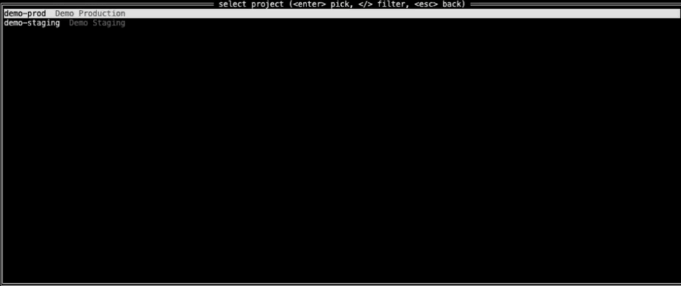

# r9s

A tiny [k9s](https://k9scli.io)-style terminal UI for Google Cloud Run.



## Requirements

- [Go](https://go.dev/dl/) 1.26+ to build
- [`gcloud`](https://cloud.google.com/sdk/docs/install), logged in (`gcloud auth login`)

## Install

```sh
go install github.com/pavel-durov/r9s/cmd/r9s@latest
```

Or from a clone: `just install` (or `just run` to build and start).

## Usage

```sh
r9s                      # opens the project picker
r9s -project my-project  # skips the picker
r9s -mock                # built-in demo projects, services and jobs; no gcloud needed
```

| key | action |
|---|---|
| `p` | pick project |
| `tab` | switch between services and jobs |
| `j`/`k`, arrows | move |
| `enter` / `d` | describe (in `less`) |
| `e` | edit YAML in `$EDITOR`, then `gcloud run ... replace` after a y/N confirm |
| `l` | last 1000 log lines (in `less`) |
| `L` | live tail logs, `ctrl-c` to stop |
| `s` | SSH into an instance |
| `o` | open in the GCP console |
| `/` | filter by name |
| `esc` | back |
| `r` | refresh |
| `?` | show key bindings |
| `q` | quit |

## Development

```sh
just test 
just fmt
```

The code is two small packages: `pkg/cloudrun` (gcloud calls and row formatting) and `pkg/ui` ([tview](https://github.com/rivo/tview) front end).

## Contributing

Issues and PRs are welcome. Please run `just test` and `just fmt` first.

## License

[MIT](LICENSE)
